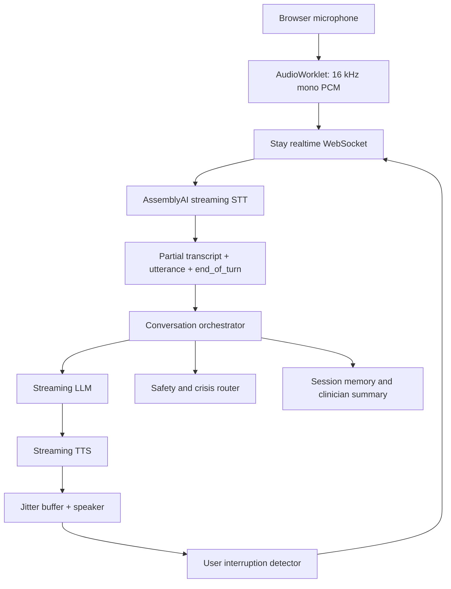

# Architecture

Stay is a Next.js 15 (App Router, React 19, TypeScript, Tailwind v4) real-time voice application designed specifically for task initiation and executive dysfunction in ADHD. Almost everything runs in the browser; the server is a secure, low-latency edge layer that holds ephemeral tokens, enforces deterministic safety gates, and routes completions.

## Real-Time Speech Architecture

### Component Mapping & Source Implementation

| Node in Diagram | Role & Responsibilities | Codebase Implementation |
|---|---|---|
| **Browser microphone** | Web Audio `getUserMedia` with hardware Echo Cancellation (AEC), Noise Suppression (NS), and Automatic Gain Control (AGC). | `src/lib/voice/useVoiceAgent.ts` |
| **AudioWorklet: 16 kHz mono PCM** | Low-latency audio capture processor running on Web Audio rendering thread, streaming 16-bit linear PCM in 50ms chunks. | `public/pcm-processor.js`, `src/lib/voice/playback/pcm16.ts` |
| **Stay realtime WebSocket** | High-performance full-duplex socket (`FastSocket`) managing auth handshakes, binary frames, epoch tagging, and heartbeat ping/pong. | `src/lib/voice/fastSocket.ts`, `src/app/api/voice/fast-token/route.ts` |
| **AssemblyAI streaming STT** | Universal-Streaming v3 WebSocket connection transcribing speech in real-time with zero-latency partial stabilization. | `streaming.assemblyai.com/v3/ws`, `src/lib/voice/fastSocket.ts` |
| **Partial transcript + utterance + end_of_turn** | Multi-tiered turn detection: partials drive real-time captions & neural orb morphing; `utterance` triggers speculative LLM generation; `end_of_turn` finalizes prompt. | `src/lib/voice/fastSocket.ts`, `src/lib/voice/captionSync.ts` |
| **Conversation orchestrator** | State machine coordinating tool execution (`app`), turn cadence, ADHD hesitation holding (2.2s patience window), and multi-turn context. | `src/lib/voice/fastSocket.ts`, `src/lib/voice/agenticActions.ts` |
| **Safety and crisis router** | Deterministic multilingual interceptor evaluating every transcript, before the LLM is called for typed text and fast voice (in standard voice the managed agent's model hears the speech too, so the check runs as transcripts arrive), routing crisis prompts to emergency resources. | `src/lib/safety/crisis.ts`, `src/app/api/coach/plan/route.ts` |
| **Session memory & clinician summary** | Privacy-first local storage repository, cognitive tracking, and structured export for ADHD clinical check-ins & PDF reports. | `src/lib/storage/repository.ts`, `src/lib/pdf/clinicianReport.ts` |
| **Streaming LLM** | Ultra-low latency streaming model (`openai/gpt-oss-120b` on Groq, OpenAI, or user BYOK) generating concise 1-step task breakdowns. | `src/app/api/voice/chat/route.ts`, `src/app/api/coach/plan/route.ts` |
| **Streaming TTS** | Real-time text-to-speech synthesis (AssemblyAI Streaming TTS + Azure Neural TTS + Browser SpeechSynthesis). | `src/lib/voice/tts/`, `src/app/api/voice/tts/route.ts` |
| **Jitter buffer + speaker** | Custom AudioWorklet ring buffer decouples network delivery jitter from audio DAC clock, ensuring smooth continuous playback with zero gap clicks. | `public/worklets/stay-pcm-playback-processor.js`, `src/lib/voice/playback/continuousPlayback.ts` |
| **User interruption detector** | Barge-in: when you talk over Stay its voice ducks at once, and once two or more words or a stop word are heard it sends a Cancel (a new epoch) and flushes the audio buffer. Measured time to go quiet after being talked over: a median 371 ms in the synthetic-microphone bench (3 tries, `docs/evidence/loop/T2-bench-2026-11-02-series2.json`) and 187 to 849 ms in four saved real-call runs (`docs/evidence/real-e2e/`). Not a fixed sub-100 ms figure. | `src/lib/voice/playback/epochs.ts`, `src/lib/voice/fastSocket.ts` |

## Voice

* **Fast voice (default)** for English, Spanish, French, German, Italian and Portuguese. Speech-to-text is Universal-3.6 Pro streaming over a WebSocket opened by the browser with a token minted by `/api/voice/fast-token`. Turn handling is in `FastSocket`: partials drive the orb and captions, `end_of_turn` starts the reply, a turn that ends on "um", a connector or a comma is held for 2.2 s and merged with what follows (patience for ADHD pauses), two words over Stay's own speech cancel it, a single stray word does not.
* **The brain** is `/api/voice/chat`: safety gates first (crisis, medication), then a streamed chat completion. Default model is `openai/gpt-oss-120b` on Groq; a person's own key (Groq, Mistral, OpenAI, any public https OpenAI-compatible address) is used first when present. One compact tool, `app`, carries every action so each extra capability does not add reply latency.
* **Speech** is AssemblyAI streaming text-to-speech (protocol found by probing: `Generate`, `Flush`, `Cancel`, `Terminate`; audio is base64 PCM 24 kHz; voice and language are query parameters). The first clause of a reply is spoken as soon as it exists; simple actions are confirmed at once with a canned line instead of a second model call.
* **Standard voice** is AssemblyAI's managed Voice Agent API. It runs when fast voice is switched off and for languages fast voice does not hear (`useVoiceAgent.ts`, `useFast`). It is not a fallback for fast voice failing: a fast connection that fails before it is ready is retried twice with fresh tokens, and after that the app says "Text only" (typing keeps working; tapping Talk tries again), or uses the browser's own speech recognition and voice after a fatal session error, and labels it "Device voice".

## Safety layer

`src/lib/safety/crisis.ts` is deterministic and multilingual. It runs in the browser on every transcript and typed message, and again on the server in `/api/coach/plan`, `/api/coach/triage`, `/api/voice/chat` and `/api/orb/shape` before any model sees the text (except in standard voice, where AssemblyAI's managed agent hears the speech itself and Stay checks each transcript as it arrives). Crisis wording stops coaching and opens help; dose and medication questions get a fixed reply that points to a prescriber. Voice can never delete data: "delete my data" only opens Settings.

## Data

Everything a person creates is in `localStorage` under `stay_*` keys (profile, sessions, memory, calibration, voice preferences, today list, parked thoughts, routines, reminders, their own API keys) and is wiped by "Delete all my data". Optional Supabase sync is row-level-security protected and off by default. The server stores nothing about conversations.

## Server routes

| Route | Job |
|---|---|
| `/api/voice/fast-token` | Two short-lived AssemblyAI tokens (speech-to-text, text-to-speech); 30 min sessions on the shared key, 3 h on a person's own key |
| `/api/voice/chat` | Streaming reply and tool calls; warm-up `GET` |
| `/api/voice/token` | Voice Agent token (fallback engine) |
| `/api/coach/plan` | First step, strategy and block length (no shared cache) |
| `/api/coach/triage` | Brain dump into one thing now, a few for today, the rest later; deterministic fallback |
| `/api/orb/shape` | Names the best emoji for a word the library does not have; only keywords, never sentences |
| `/api/keys/check` | Tests a person's own key with one tiny call |
| `/api/account/delete` | Deletes cloud rows when signed in |

Own-key requests: https only, no URL credentials, redirects never followed, the host is resolved and refused if any answer is private (`src/lib/llm/provider.ts`), 120 requests a minute per address. Shared-key requests are limited per address. These limits are in-memory per server instance; a production deployment needs a shared store (stated here so nobody assumes otherwise).

## The orb

One field of 3,200 to 5,200 dots drawn with Three.js points. A shape is a different target for the same dots. Sources, fastest first: 38 hand-built shapes from a small signed-distance drawing language (tangle, stairs, battery, target, list, coin, envelope and others), an offline word table, the shape service, a deterministic rosette. Only dots are drawn.

While Stay speaks the dots also pour into a person (hair, head, neck, shoulders) whose mouth follows the agent's real audio, with blinks, breath and head movement; transitions are springy and jelly-like. How it works, how to add shapes, and the measured frame times are in [THERAPIST_ORB.md](THERAPIST_ORB.md).

## Front end

Mobile-first shell (bottom tab bar on phones, header on desktop, Urgent help always in the header). A service worker keeps the shell available offline. Content-Security-Policy restricts scripts, styles, fonts and connections to what the app uses.

## Tests and evidence

1,613 unit tests passed and 1 skipped in `npx vitest run` on 4 Nov 2026, 218 browser tests listed by `npx playwright test --list` (not run for this count) and the voice harnesses in `scripts/voice-e2e/` (`sim-human.mjs`, `cascade-bench.mjs`, `compare-bench.mjs`, `force-endpoint-probe.mjs`, `fast-app-bench.mjs`). Raw outputs of the simulated-speaker runs are in `docs/bench-results/`. Method, sources and corrections are in `RESEARCH_VOICE_LATENCY.md` and `STAY_VERIFICATION_2026-10-18.md`.
