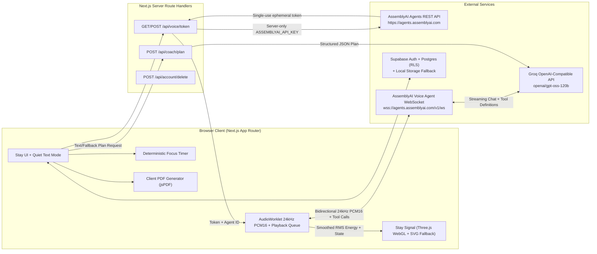

# Architecture Specification (`docs/ARCHITECTURE.md`)

## 1. High-Level System Architecture

---

## 2. Voice Pipeline Architecture

1. **Token Minting (`/api/voice/token`):**
   - Browser requests a short-lived token before opening a voice session.
   - Server validates rate limits and calls `GET https://agents.assemblyai.com/v1/token?expires_in_seconds=180&max_session_duration_seconds=600` with `Authorization: Bearer <ASSEMBLYAI_API_KEY>`.
   - Returns `{ token, agentId, wsUrl: "wss://agents.assemblyai.com/v1/ws" }`.
2. **Session Initialization:**
   - Browser opens `wss://agents.assemblyai.com/v1/ws?token=<token>`.
   - On `open`, sends `{"type": "session.update", "session": {"agent_id": "<agentId>"}}`.
   - Waits for `session.ready` before streaming microphone audio.
3. **Microphone Capture & Resampling (`public/pcm-processor.js`):**
   - Uses default `AudioContext` sample rate so Firefox `echoCancellation: true` and Safari native rates work reliably.
   - `AudioWorkletProcessor` resamples float32 audio to `24000` Hz mono, converts to signed 16-bit little-endian PCM (`Int16Array`), buffers ~50ms chunks (`1200` samples = `2400` bytes), base64-encodes them, and sends `{"type": "input.audio", "audio": "<base64>"}`.
   - Also computes local RMS audio energy (`0.0–1.0`) to drive the **Stay Signal** 3D instrument smoothly.
4. **Agent Audio Playback & Barge-In:**
   - Incoming `reply.audio` chunks (`24000` Hz PCM16 base64) are decoded to `Float32Array` and scheduled gaplessly on the `AudioContext` timeline.
   - When `input.speech.started` or `reply.done` (`status: "interrupted"`) arrives, all active `AudioBufferSourceNode` instances are immediately stopped and cleared, resetting the playback cursor for clean barge-in.
5. **Client-Side Tool Execution:**
   - Stored agent `agent_c70c56210f7c41548f7785d33dc6c8ab` declares three client-side tools:
     - `propose_coaching_plan`: Populates the task, barrier, strategy, shrunk <2-minute first step, and recommended timer duration on screen.
     - `start_focus_timer`: Starts the application-owned countdown timer.
     - `record_session_outcome`: Logs the session outcome (`started`, `partly_started`, `not_started`, `paused_or_stopped`).
   - Tool results are queued when `tool.call` arrives and sent as `{"type": "tool.result", "call_id": "...", "result": "...", "is_error": false}` after `reply.done` (`status !== "interrupted"`), matching the official AssemblyAI Voice Agent state machine.
6. **Clean Session Teardown:**
   - Sends `{"type": "session.end"}` on user stop, component unmount, and `window` `pagehide` before closing the WebSocket.

---

## 3. Deterministic Safety & Fallback Guarantees

- **Pre-LLM Crisis Intercept:** Every user transcript and text input runs through `detectCrisisSignal()` (`src/lib/safety/crisis.ts`) *before* coaching plan generation. If triggered, any active voice session is ended (`session.end`), timers are paused, and the UK Crisis Help Panel is opened immediately.
- **Pre-LLM Medication Dosing Intercept:** `detectMedicationAdviceRequest()` detects dosing/prescription requests and returns a fixed safe boundary message directing the user to their prescriber or pharmacist.
- **Text-Only Parity:** Every action available via voice (task capture, barrier selection, strategy proposal via `/api/coach/plan`, timer control, outcome logging, treatment check-in, and clinician PDF export) works identically in Quiet Text Mode without microphone permissions.
