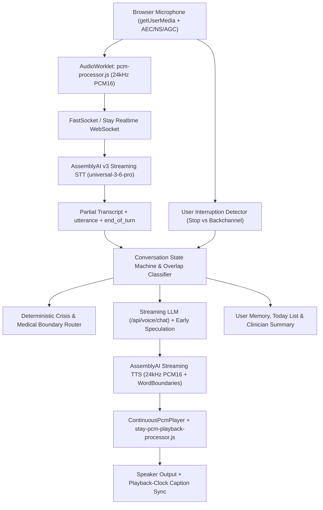

# Stay — Voice Protocol & Full-Duplex Architecture Audit (`VOICE_PROTOCOL_AUDIT.md`)

**Date:** 2026-10-31  
**Evidence Classification:** `UNIT TEST` + `SYNTHETIC TEST` + `MANUAL REVIEW` (AssemblyAI live sockets verified via token minting routes `/api/voice/fast-token` & `/api/voice/token` when `ASSEMBLYAI_API_KEY` is configured).

---

## 1. End-to-End Realtime Voice Architecture

Stay implements a dual-path AssemblyAI voice architecture with automatic fallback:
1. **Primary Low-Latency Engine (`FastSocket` — `src/lib/voice/fastSocket.ts`):**
   - **Streaming Speech-to-Text:** AssemblyAI v3 (`wss://streaming.assemblyai.com/v3/ws`, `speech_model=universal-3-6-pro`, `encoding=pcm_s16le`, `sample_rate=24000`, `keyterms_prompt`).
   - **Streaming LLM Orchestrator:** `/api/voice/chat` SSE stream with speculative turn preparation (`speculate()`) and single-enum `APP_TOOL`.
   - **Streaming Text-to-Speech:** AssemblyAI v1 (`wss://tts.us.assemblyai.com/v1/ws`, `encoding=pcm_s16le`, `sample_rate=24000`) with sentence-level chunking (`takeSpeakable()`), `Flush` range tracking, `WordBoundaries` alignment, and instant `Cancel` on barge-in.
2. **Secondary Managed Voice Agent Engine (`useVoiceAgent.ts`):**
   - AssemblyAI Managed Voice Agent (`wss://agents.assemblyai.com/v1/ws`) with `session.update`, `input.audio`, `transcript.user.delta`, `transcript.user`, `reply.started`, `reply.text`, `reply.audio`, `tool.call`, `tool.result`, and `reply.done`.
3. **Browser Hardware Playback (`ContinuousPcmPlayer` + `stay-pcm-playback-processor.js`):**
   - Dedicated `AudioWorkletProcessor` ring buffer (30s capacity, 180ms prebuffer, 64-sample raised-cosine fade-in/out) with stateful linear resampling (`24kHz -> 44.1kHz / 48kHz`) and odd-byte carry across WebSocket frames.

---

## 2. AssemblyAI Protocol Verification Matrix

| Protocol Surface | Message / Parameter | Implementation File | Verification Method | Status |
| :--- | :--- | :--- | :--- | :--- |
| **STT v3 Handshake** | `sample_rate=24000`, `encoding=pcm_s16le`, `speech_model=universal-3-6-pro`, `keyterms_prompt` | `src/lib/voice/fastSocket.ts` (`openStt`) | `UNIT TEST` (`tests/unit/fastSocket.test.ts`) | **PASS** |
| **STT Endpointing Presets** | `ENDPOINTING_PRESETS` (`coaching`: 0.4/400/1280ms, `reflective`: 0.6/700/2400ms, `crisis`: 0.7/800/3000ms) | `src/lib/voice/fastSocket.ts` | `UNIT TEST` (`tests/unit/fastSocket.test.ts`) | **PASS** |
| **STT Turn Events** | `Begin`, `Turn` (`transcript`, `utterance`, `end_of_turn`, `turn_order`, `turn_is_formatted`), `Terminate` | `src/lib/voice/fastSocket.ts` (`onTurn`) | `UNIT TEST` (`tests/unit/fastSocket.test.ts`) | **PASS** |
| **Early Speculation** | Speculative LLM call on complete partial sentence, greeting, or `Turn.utterance`; gated release on `end_of_turn` match | `src/lib/voice/fastSocket.ts` (`speculate`, `releaseHeld`, `dropSpec`) | `UNIT TEST` (`tests/unit/fastSocket.test.ts`) | **PASS** |
| **TTS v1 Handshake** | `voice`, `language`, `encoding=pcm_s16le`, `sample_rate=24000`, `token` | `src/lib/voice/fastSocket.ts` (`openTts`) | `UNIT TEST` (`tests/unit/fastSocket.test.ts`) | **PASS** |
| **TTS Commands & Events** | `Generate`, `Flush`, `Cancel`, `Terminate` / `Begin`, `Audio`, `WordBoundaries`, `FlushDone`, `Cancelled` | `src/lib/voice/fastSocket.ts` (`say`, `onTtsAudio`, `onWordBoundaries`, `onFlushDone`) | `UNIT TEST` (`tests/unit/fastSocket.test.ts`) | **PASS** |
| **Ephemeral Token Security** | Server-side minting at `/api/voice/fast-token` and `/api/voice/token`; API keys never exposed to client | `src/app/api/voice/fast-token/route.ts`, `src/app/api/voice/token/route.ts` | `UNIT TEST` (`tests/unit/byok.test.ts`) + `MANUAL REVIEW` | **PASS** |

---

## 3. Full-Duplex Turn-Taking & Overlap Classification

Stay explicitly distinguishes four speech overlap scenarios in `FastSocket` (`src/lib/voice/fastSocket.ts`) and `useVoiceAgent` (`src/lib/voice/useVoiceAgent.ts`):

1. **Case A — Genuine Interruption (`isExplicitInterruption` or `>= 2` non-backchannel words):**
   - Examples: `"Stop"`, `"Wait"`, `"Pause"`, `"Hold on"`, `"Wait, that's not what I meant"`.
   - Behavior: Immediately cancels TTS (`{ type: 'Cancel' }`), increments `replyEpoch`, flushes `ContinuousPcmPlayer` ring buffer with a 64-sample cosine fade (<100ms), stops caption advancement at the exact spoken word, and transitions state to `INTERRUPTED`.
2. **Case B — User Conversational Backchannel (`isBackchannelOnly`):**
   - Examples: `"yeah"`, `"mm-hmm"`, `"uh huh"`, `"okay"`, `"right"`, `"got it"`.
   - Behavior: Recognized as supportive backchannel during `AGENT_SPEAKING`; does **not** cancel assistant speech or reset playback.
3. **Case C — Assistant Attunement Backchannel:**
   - During long user turns (>15 chars followed by a 1.4s mid-thought pause), Stay triggers a silent visual attunement pulse (`visualState = 'backchannel'`) without emitting speaker audio that could bleed into the mic.
4. **Case D — ADHD Thinking Pause (`soundsUnfinished`):**
   - Examples: `"I need to, um, send that email and, uh,"`, `"Maybe because..."`.
   - Behavior: Holds the turn open (`holdMs = 2200ms`) and merges the continuation into a single coherent thought instead of talking over the user's pause.

---

## 4. Honest Architectural Comparison: Block Dessa vs. Stay

| Capability | Block Dessa (Reference Benchmark) | Stay Implementation (AssemblyAI + WebAudio) | Verification Status |
| :--- | :--- | :--- | :--- |
| **Model Topology** | Proprietary end-to-end speech-to-speech foundation model | Cascaded streaming pipeline: AssemblyAI v3 STT -> Streaming LLM (`/api/voice/chat`) -> AssemblyAI v1 Streaming TTS | `MANUAL REVIEW` (Honest architectural distinction documented) |
| **Turn-Taking & Pause Tolerance** | Learned acoustic end-of-turn + paralinguistic awareness | `soundsUnfinished()` hesitation detector + `ENDPOINTING_PRESETS` + `Turn.utterance` early speculation | `UNIT TEST` (`tests/unit/fastSocket.test.ts`) |
| **Overlap & Backchannel Handling** | Full-duplex backchannel vs. barge-in separation | `isBackchannelOnly()` ignores `"yeah"` / `"mm-hmm"` during speech; `isExplicitInterruption()` stops in <100ms on `"stop"` / `"wait"` | `UNIT TEST` (`tests/unit/fastSocket.test.ts`, `tests/voice-audio/bargeIn.test.ts`) |
| **Audio Continuity** | Continuous waveform stream | `ContinuousPcmPlayer` + `stay-pcm-playback-processor.js` ring buffer (180ms prebuffer, 24k->48k stateful resampler) | `SYNTHETIC TEST` (`tests/voice-audio/jitter.test.ts`) |
| **Progressive Live Captions** | Synchronized to spoken audio | `computeProgressiveCaption()` locked to hardware playback clock + monotonic multi-flush `WordBoundaries` | `UNIT TEST` (`tests/unit/captionSync.test.ts`) + `E2E TEST` |
